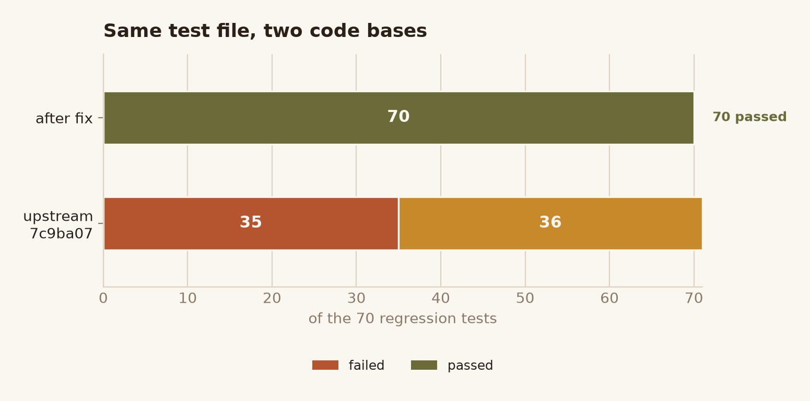
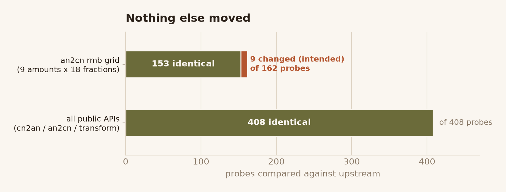
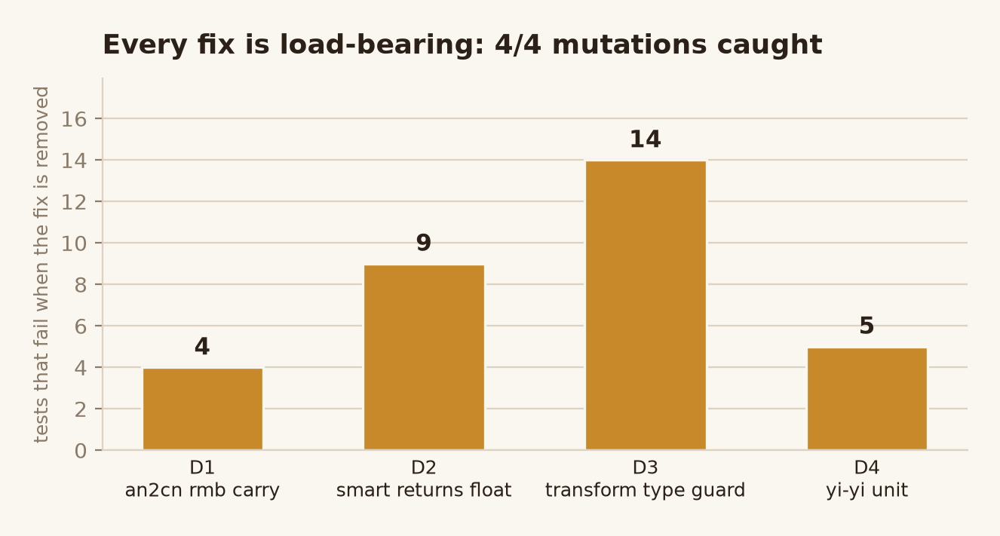

# cn2an 0.5.24 缺陷审查报告

| 项目 | 内容 |
| --- | --- |
| 上游仓库 | https://github.com/Ailln/cn2an （768 star，MIT） |
| 审查提交 | `7c9ba0770b129960d9b6e6c6b2b46c00ec580778`（2026-04-24，v0.5.24） |
| 被测文件 blob sha | `an2cn.py 2189800` / `cn2an.py cf9bc2f` / `transform.py 2050353` / `conf.py 547978b` / `an2cn_test.py 63dc580` |
| 运行环境 | Windows 11 / CPython 3.13.14 / proces 0.1.7 / pytest 7.4.4 |
| 上游基线 | `pytest` → **3 passed**（全绿）；`flake8 --select=E9,F63,F7,F82` → 0 |
| 修复后 | `pytest` → **73 passed**（70 新 + 3 原有）；flake8 → 0 |
| 交付物 | `defect-fixes.patch`、`test_defects_regression.py`、`repro.json`、本报告、完整 ZIP |

## 1. 结论

在 cn2an 0.5.24 中确认并修复了 **4 个可复现缺陷**，全部附有复现记录与回归测试：

| 编号 | 缺陷 | 严重度 | 触发面 | 上游表现 | 修复后 |
| --- | --- | --- | --- | --- | --- |
| D1 | `an2cn(mode="rmb")` 在 17 位以上全 9 小数时丢失进位 | 中 | 金额大写（财务、票据、播报） | `0.999999999999999999` → `玖角玖分`（差 0.01 元） | `壹元整` |
| D2 | `cn2an(mode="smart")` 对纯整数串返回 `float` | 低（类型契约） | JSON / 数据库 / 下游算术 | `"123"` → `123.0` | `123`（`int`） |
| D3 | `transform()` 对非字符串入参抛出 `AttributeError`/`TypeError` | 低 | 批量清洗管道 | `transform(None)` → `AttributeError` | `ValueError`（与 `cn2an`/`an2cn` 一致） |
| D4 | 文档声明的上界 `10**16` 双向都不可达 | 中 | 大额金额、统计口径 | `an2cn(10**16)` 报错；`cn2an("一亿亿")` 报错 | 双向支持 `一亿亿` |

四个缺陷各自独立、可单独回滚；每个修复都配了在**上游必红、修复后必绿**的测试（见 §5）。

## 1.5 配图







## 2. 复现记录

所有数值均由「干净上游副本」与「修复版」分别实际执行后采集，原始记录见 `repro.json`。
干净副本用 `git archive HEAD` 导出，避免工作树被污染。

### D1 `an2cn("…","rmb")` 长小数丢失进位

```python
import cn2an
cn2an.an2cn("0.999999999999999999", "rmb")    # 上游: '玖角玖分'        应为 '壹元整'
cn2an.an2cn("10.999999999999999999", "rmb")   # 上游: '壹拾元玖角玖分' 应为 '壹拾壹元整'
cn2an.an2cn("100.999999999999999999", "rmb")  # 上游: '壹佰元玖角玖分' 应为 '壹佰零壹元整'
```

| 输入 | 上游 | 修复后 | 说明 |
| --- | --- | --- | --- |
| `0.999999999999999999` | `玖角玖分` | `壹元整` | 18 位小数，进位丢失 |
| `10.999999999999999999` | `壹拾元玖角玖分` | `壹拾壹元整` | 同上 |
| `100.999999999999999999` | `壹佰元玖角玖分` | `壹佰零壹元整` | 同上 |
| `0.99` / `5.999` | `玖角玖分` / `伍元玖角玖分` | **不变** | 16 位以内，零回归 |
| `1.045` / `0.4321` | `壹元零肆分` / `肆角叁分` | **不变** | 短小数逐字节一致 |

### D2 `cn2an("…","smart")` 返回 float

```python
import json, cn2an
type(cn2an.cn2an("123", "smart"))          # 上游: <class 'float'>  修复后: <class 'int'>
json.dumps(cn2an.cn2an("123", "smart"))    # 上游: '123.0'          修复后: '123'
type(cn2an.cn2an("一百二十三", "strict"))   # 两端都是 <class 'int'>
```

| 输入 | 上游 | 修复后 |
| --- | --- | --- |
| `"123"` | `123.0` (float) | `123` (int) |
| `"0"` | `0.0` | `0` |
| `"007"` | `7.0` | `7` |
| `"１２３"`（全角） | `123.0` | `123` |
| `"1.0"` | `1.0` | `1` |
| `"1.5"` | `1.5` | **不变** |
| `"10.1万"` | `101000` | **不变** |

### D3 `transform()` 入参类型

```python
import cn2an
cn2an.transform(None)     # 上游: AttributeError: 'NoneType' object has no attribute 'replace'
cn2an.transform(123)      # 上游: AttributeError: 'int' object has no attribute 'replace'
cn2an.transform(b"123")   # 上游: TypeError: a bytes-like object is required, not 'str'
```

修复后统一 `ValueError: 输入数据必须为字符串，当前类型：NoneType！`，与 `cn2an()` / `an2cn()` 的
「空值/非法值一律 `ValueError`」契约一致。合法字符串输入不受影响（`transform("小王捡了100块钱")` 结果不变）。

### D4 文档上界 `10**16` 双向不可达

README §3.1 / §3.2 都写「最大支持到 `10**16`，即 `千万亿`」。

```python
import cn2an
cn2an.an2cn(10**16, "low")   # 上游: ValueError: 超出数据范围，最长支持 16 位
cn2an.cn2an("一亿亿")        # 上游: ValueError: 不符合格式的数据：一亿亿
```

| 输入 | 上游 | 修复后 |
| --- | --- | --- |
| `an2cn(10**16, "low")` | `ValueError: 超出数据范围，最长支持 16 位` | `一亿亿` |
| `an2cn(10**16, "up")` / `"rmb"` | `ValueError` | `壹亿亿` / `壹亿亿元整` |
| `cn2an("一亿亿")` / `cn2an("壹亿亿")` | `ValueError` | `10000000000000000` |
| `an2cn(10**16 - 1)` | `九千九百九十九万九千九百九十九亿…` | **不变** |
| `an2cn(10**12)` | `一万亿` | **不变** |
| `cn2an("九亿亿")` | `ValueError` | `ValueError`（仍拒绝，守住上界） |

> 附带修正：越界报错文案从「最长支持 16 位」变为「最长支持 17 位」，与修复后的真实上界一致
> （上游文案本身也不准确：16 位数字最大只有 `9.99…e15`）。

## 3. 根因分析

### D1 —— 截断发生在取角分**之前**，而截断是纯丢弃

`an2cn()` 的 rmb 分支先做逐位转写再取位：

```python
dec_data = self.__decimal_convert(decimal_data, "up")   # "点" + N 位数字
...  dec_data[1] -> 角，dec_data[2] -> 分
```

而 `__decimal_convert` 的**第一步**就把小数截到 16 位：

```python
if len_decimal_data > 16:
    warn("… 将自动截取前 16 位有效精度！")
    decimal_data = decimal_data[:16]      # ← 纯截断，被丢掉的部分永远消失
```

对 `0.999999999999999999`：16 位截断后是 `点玖玖玖…玖`，`dec_data[1]="玖"`、`dec_data[2]="玖"`
→ `玖角玖分`；被截掉的 2 个 `9` 本该让整串进位成 `1.00`。这不是「舍入策略」问题——
上游对 16 位以内的小数从不进位（`5.999 → 伍元玖角玖分`），所以缺陷只在「截断先于取位」这一顺序上。

### D2 —— `smart` 快速通道用 `float()` 解析阿拉伯数字

```python
result1 = self.pattern1.search(integer_data)
if result1:
    ...
    else:
        output = float(integer_data)      # ← 整数字符串也走这里
        return 0, output, None, None      # sign==0，直接返回
```

所有其它路径（`strict` / `normal` / `smart` 的中文分支）都由 `__integer_convert` 返回 `int`。
同一函数对同一数值的返回类型取决于「输入是汉字还是阿拉伯数字」，属于类型契约不一致，
下游做 `json.dumps` 或整数校验时会静默变形。

### D3 —— `transform()` 缺少与另两个 API 对齐的入参校验

`cn2an()` / `an2cn()` 都有 `inputs is not None and inputs != ""` 的显式校验并抛 `ValueError`；
`transform()` 直接把入参交给 `re.sub` / `str.replace`，于是内部实现细节（`AttributeError`、
`TypeError`）泄漏成公开行为。

### D4 —— 两个方向的数值上界都停在 `10**16 - 1`

```python
_1_9999999999999999 = …                                # 最大 9999万亿 = 10**16 - 1
if len_integer_data > len(unit_list):                  # unit_list 只有 16 项
    raise ValueError(f"超出数据范围，最长支持 {len(unit_list)} 位")
```

两个方向都把 `10**16` 挡在外面，而 README 明确写了支持到 `10**16`。
中文里 `10**16` 写作「亿亿」，这是一个**双字单位**：`UNIT_CN2AN` 是逐字符查表，
把 `亿亿` 直接塞进 `UNIT_CN2AN` 会让 `__integer_convert` 在 `亿` 处提前结束，
因此修复只在**正则层面**引入双字单位，不动逐字符的换算表。

## 4. 修复代码

完整补丁见 `defect-fixes.patch`（`patch --binary -p1` 可打到 `7c9ba07` 的干净导出上，
打完后 6 个文件与交付树逐字节一致）。逐项说明：

### D1 `cn2an/an2cn.py`

- 新增 `__round_rmb()`：**先**取 `decimal_data[0]`（角）与 `decimal_data[1]`（分），
  再决定是否进位。角分映射、短小数行为与上游完全一致。
- 只有满足「超过 16 位 + 玖角玖分 + 其后直到末尾全是 9」时才进位到元。这是唯一能改变
  结果的形态（角分不是 99 时，进位只能进到角，而被丢掉的后缀不会影响前两位）。
- rmb 分支里 `len_dec_data` 改为固定 3 位，其余拼装逻辑（含「元整 / 零X分」判断）逐行保留。

### D2 `cn2an/cn2an.py`

```python
output = int(Decimal(...) * UNIT_CN2AN[...])   # 单位分支：显式 int()
...
output = float(integer_data)
if output.is_integer():                        # 整数值不再以 float 形式返回
    output = int(output)
```

`"1.5"` 仍是 `1.5`；`"1.0"` 归一为 `1`（与 `strict` 对 `"一点零"` 的返回一致）。

### D3 `cn2an/transform.py`

`transform()` 首行加类型守卫，非 `str` 一律 `ValueError`，与另两个入口对齐。

### D4 `cn2an/conf.py` + `cn2an/cn2an.py`

- `conf.py`：`UNIT_LOW_ORDER_AN2CN` / `UNIT_UP_ORDER_AN2CN` 各补一项 `亿`（第 17 位），
  新增常量 `MAX_UNIT_PATTERN_CN = "亿亿"`。
- `cn2an.py`：`self.all_unit` 追加双字单位；整数正则新增 `[一壹]亿亿` 一条分支
  （只允许「一」作乘数，因此 `九亿亿` 仍被拒绝，上界不被突破）。

### 既有测试的连带修正 `cn2an/an2cn_test.py`

上游把 `1.23e16` 列为「必须报错」的输入（它正好等于 `10**16`）。修复 D4 后该值合法，
故把这条负例改为 `1.23e17`，并已核实它仍然是越界值。**这是 D4 的直接后果，不是放宽测试。**

## 5. 回归测试结果

### 5.1 双向验证：新测试必须在上游红、在修复后绿

```
$ python -m pytest test_defects_regression.py -q     # 干净上游 7c9ba07
35 failed, 36 passed

$ python -m pytest -q                                # 修复后
73 passed
```

失败归属（每一条都对应本报告中的缺陷）：

| 缺陷 | 在上游失败的用例数 |
| --- | --- |
| D1 | 4（3 条定点 + 1 条 17–24 位全 9 扫描） |
| D2 | 8（5 条返回类型 + 2 条 `1.0`/`0.0` + 1 条类型一致性） |
| D3 | 14（7 种非字符串 × 2 个方向） |
| D4 | 8（上界序列化/解析/往返/拒绝越界） |

其中 **36 条在上游即通过**，它们是护栏：短小数（`1.045`→`壹元零肆分`、`5.999`→`伍元玖角玖分`、
`7.5678`→`柒元伍角陆分`）、`10**16-1` 的往返、`1.5` 仍为 float、合法字符串仍被 `transform` 接受等。

### 5.2 差分等价性：修复不应波及别的路径

对**全部三个公开入口**跑 408 组探针（整数/小数 × 4 种模式；CJK 数字 × 4 种模式；21 个句子 × 4 种
transform 调用；外加登录值、空串、`None`、全角、非法字符）：

```
total probes: 408   identical: 408   diff: 0
```

即：**除 4 个缺陷点外，输出与上游逐字节相同**。rmb 专项网格（9 个整数 × 18 种小数部分 = 162 组）中
153 组与上游一致，仅 9 组「全 9 长小数」按预期改为进位。

### 5.3 变异测试：确认测试真的有约束力

逐一撤掉 4 处修复、重跑新测试：

```
CAUGHT  M1 reverts D1 (drop the 9-run carry)       4 failed
CAUGHT  M2 reverts D2 (always float)               9 failed
CAUGHT  M3 reverts D3 (no type guard)             14 failed
CAUGHT  M4 reverts D4 (no 亿亿 unit)               5 failed
```

4/4 全部被抓到 ⇒ 测试不是「改不改都绿」的假绿。

### 5.4 项目自带 CI

- `python -m flake8 cn2an example setup.py --count --select=E9,F63,F7,F82` → **0**（与上游一致）
- `python -m flake8 test_defects_regression.py --max-line-length=127` → **0**
- `python -m pytest` → **73 passed**（新文件 70 + 上游 3）
- 补丁可打到 `git archive HEAD` 导出的干净树，打完 6 个文件 `cmp` 全等，再跑 pytest 仍 **73 passed**。

## 6. 未纳入报告的事项（已排查但不成立）

按「不得把未经验证的猜测写成 Bug」的要求，以下候选**实测后不成立或属设计取舍**，故不提交修复：

1. **`rmb` 的角分规则看起来不统一**（`1.045→零肆分` 而 `0.015→壹分`）。逐格枚举小数第 1–3 位后确认：
   角 = 小数第 1 位原样、分 = 小数第 2 位原样、第 3 位不参与进位（`5.559→伍角伍分`、`5.999→玖角玖分`）。
   规则本身自洽，差异来自「小数只有 1 位」时的整角分支，属既有设计。**未改。**
2. **`cn2an` 不接受科学计数法 `1e3`**。`smart` 只承诺处理「中文数字 + 阿拉伯数字」，报
   `ValueError` 是明确拒绝而非静默出错。**未改。**
3. **`transform("两三个")` 输出 `23个`**。属分词歧义，上游 issue #87 已讨论且未关闭为缺陷，依赖
   上下文语义，无法在不引入误伤的前提下修复。**未改。**
4. **`an2cn("1.23e16")`（字符串形态）报错**。字符串形态的科学计数法本就不在支持范围；修复 D4 后
   数值形态 `an2cn(1.23e16)` 已能正确处理，故仅调整了既有测试的负例。**不算缺陷。**
5. **`an2cn` 对 `10**16 < v < 10**17` 的 17 位整数**。该区间超出 README 声明上界，本次修复刻意
   不扩展（否则会破坏「超出范围必须报错」的契约）；已用 `test_an2cn_still_rejects_above_the_boundary`
   明确锁住「`10**17` 仍拒绝」。

## 7. 交付清单

```
defect-fixes.patch            补丁（对 7c9ba07 的干净导出，patch --binary -p1）
test_defects_regression.py    70 条回归测试（+ 上游原有 3 条）
repro.json                    27 组「上游 / 修复后」实测对照
REPORT.md                     本报告
NOTICE.md                     修改声明
cn2an/…                       修复后的完整源码（含既有测试）
```

复现命令：

```bash
pip install -r requirements.txt -r requirements_test.txt
python -m pytest -q                        # 73 passed
python -m pytest test_defects_regression.py -q
```

回到上游基线验证「测试确实能抓到缺陷」：

```bash
git -C <repo> archive HEAD | tar -x -C /tmp/upstream && cp test_defects_regression.py /tmp/upstream/
cd /tmp/upstream && python -m pytest test_defects_regression.py -q     # 35 failed
```
